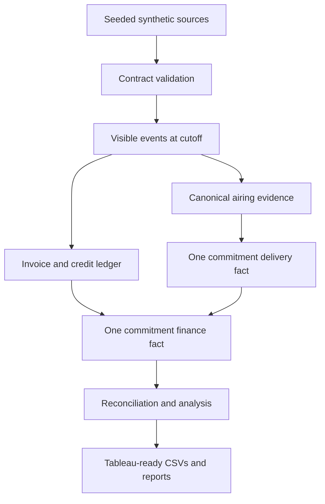

# Data model, grains and lineage

| Source | Grain | Key | Deliberate source imperfections |
|---|---|---|---|
| advertisers | One advertiser | advertiser_id | None |
| campaigns | One campaign | campaign_id | None |
| stations | One station/market/timezone | station_id | None |
| booking_lines | One station/daypart/duration/rate agreement | booking_line_id | None |
| commitments | One contracted unit | commitment_id | Cancellations |
| scheduled_spots | One planned original or replacement airing | scheduled_spot_id | Additional replacement schedules |
| airing_logs | One received feed row | ingestion_id | Source-event replays, conflicting payloads, invalid and unmatched airings |
| invoice_lines | One posted charge | invoice_line_id | Duplicate charges, rate/quantity/payer mismatches, unknown commitment |
| credits | One posted credit | credit_id | Corrective rate credits and an unknown invoice reference |

Physical SQL types, foreign keys, checks and indexes live in `sql/00_schema.sql`.
Unknown business references in operational feeds are retained for investigation;
broken core contract references and structural schema failures stop the run.

## Fanout prevention

Event replay deduplication precedes airing validation. Airings aggregate to
schedule, then to commitment. Credits aggregate to invoice line, then invoices
aggregate to commitment. Only then are delivery and billing joined. Directly
joining raw airings, invoice lines and credits would inflate counts and money.

## Availability and reproducibility

Sources contain event time and ingestion time. Every analytical snapshot uses
one explicit cutoff for airings, invoices and credits. Later snapshots can
resolve apparent earlier underdelivery. Tests reproduce such a late-log case.

Each completed run includes its raw sources, synthetic oracle files, SQLite
warehouse, analytical outputs, source SHA-256 controls and configuration-derived
metadata. The oracles are used only by validation tests, never by SQL models,
statistical estimation or reporting definitions. Perfect detection scores cover
the known injected defects only and are not real-world accuracy estimates.

The latest successful run is selected by `outputs/latest.json`. Reports and
their exact inputs are published together by one pointer replacement. File
locking prevents concurrent refreshes. This is a full rebuild implementation,
not an incremental production service. The runner targets Linux/macOS or WSL.
